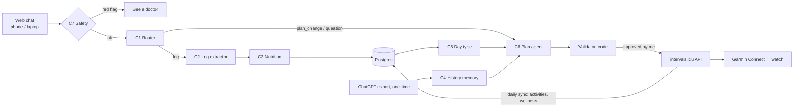

# 01 — Business understanding: Daily Coach

CRISP-DM phase: 1. Business understanding (plus first data/tool research).
Status: proposal, researched 2026-11-14. Prices and API facts change; re-check before building.

## 1. Problem

I train with a Garmin watch. Garmin Coach and Daily Suggested Workouts look at sensor data
(sleep, HRV, training load), but they do not know what actually happened in my day:

- what I ate, whether I drank alcohol, how I feel, what hurts;
- my medical history and old injuries (today kept in a long ChatGPT project, ~6 months);
- my life changes, e.g. "I am adding swimming to my week".

So the plan on the watch is often wrong for the day, and I adjust it by hand.

**Goal:** a personal web assistant I can chat with from phone and laptop. It understands
my free-text messages (Ukrainian / English / mixed), keeps a structured log of my day and my
history, decides what kind of day it is, and changes my planned training. The changed
workout appears on my Garmin watch.

**Users:** me and my brother (he also uses intervals.icu). Sign-up is limited to an email
allowlist. Each user connects their own intervals.icu key; the LLM key (OpenRouter) is shared,
with a monthly budget per user. A separate "demo athlete" account with synthetic data is used
for the course demo and evaluation, so real health data never goes into the repo.

**Core principle: context first.** Before the assistant plans or recommends anything, it
reads the user's full context (profile, gear, goals, races, zones, history wiki). It asks
questions until that context is complete enough, and every recommendation is checked against it.

## 2. What the integrations allow (researched)

| Service | Read | Write | Notes |
|---|---|---|---|
| Garmin Personal API (opened 2026-10-21) | activities, sleep, HRV, health | **no** | Self-serve key, read-only. Training/Courses push stays business-only. |
| intervals.icu API (personal API key) | activities + wellness synced from Garmin | planned workouts (events), wellness fields | Planned workouts are pushed to Garmin Connect → watch (one way, ~7-day window). Custom wellness fields (e.g. alcohol) are possible. |
| Garmin Coach | — | **no** | Cannot be changed by any API. It only reacts to activities I actually record. |

Decisions that follow:

1. **intervals.icu is the single integration for the MVP.** It already pulls Garmin data
   (read) and is the only path to put a workout on the watch (write). Garmin Personal API is
   an optional later addition for metrics intervals.icu does not have.
2. **Garmin Coach cannot "change its mind" from our side.** Recommended: turn the Garmin Coach
   plan off and let Daily Coach own the plan in intervals.icu. Otherwise the watch shows two
   competing workouts per day. Garmin's own readiness/load metrics still update from what I do.
3. Swim workouts sync to Garmin through intervals.icu, but users report bugs (rest counted as
   distance, pace units). Swim sessions will be checked on the watch early.
4. Habits or "today's parameters" cannot be written into Garmin. They are stored in our DB and
   in intervals.icu wellness fields.

## 3. Scope

In (MVP):

- Chat web app (mobile + desktop, installable as a PWA). Google sign-in, email allowlist.
- **Athlete context**, per user:
  - structured profile: height, weight history, birth year, time zone, max/resting HR, LTHR,
    HR and pace zones, swim CSS, HRV baseline, weekly availability;
  - gear: shoes and other gear, with distance and a retire-at distance;
  - goals and races: date, distance, priority A/B/C, target;
  - **history wiki** (LLM Wiki pattern): markdown pages per topic (injuries, conditions,
    nutrition, training history, life context). The AI writes and updates them from sources
    (ChatGPT export, chat), cites the source, and logs every change. I can read, edit and revert.
- **Onboarding interview:** the AI reads everything available and asks only for what is missing.
- Free-text daily logging: food, alcohol, sleep, mood/energy, soreness/pain, symptoms.
- Nutrition estimate per meal (kcal, protein, carbs, fat).
- One-time import of my ChatGPT history into a structured health/training timeline.
- Daily "day type" decision: recover / easy / normal / push, with reasons.
- Plan changes for run + swim (+ strength) written to intervals.icu → Garmin watch,
  only after I press "apply".
- Medical red flags → no training advice, "see a doctor".
- Tracing of every LLM call (for the demo) and an eval script per component.

Out (for now): Google Calendar, Silpo shopping, open sign-up, medical diagnosis,
writing to Garmin directly, native mobile app, per-user LLM keys.

## 4. Components

Each component has one purpose, a clear input and output, and its own evaluation.

| # | Component | Input → output | NLP task | Model |
|---|---|---|---|---|
| C0 | Onboarding interviewer | known context (profile, intervals.icu data, wiki) → targeted questions → filled profile fields and wiki facts | information collection dialogue (slot filling), gap detection | Flash |
| C1 | Router | chat message → intents (`log`, `question`, `plan_change`, `chat`; can be several) | multi-label classification | Flash-Lite |
| C2 | Log extractor | message → typed events: meal, alcohol, sleep, mood, pain(body part, 0–10), symptom, each with a resolved date ("вчора ввечері" → 2026-11-13 evening) | information extraction, temporal normalization, UA/EN code-switching | Flash-Lite |
| C3 | Nutrition estimator | meal text → kcal + macros, with the food items it matched | entity linking to a food database (USDA FoodData Central / Open Food Facts), LLM fallback | Flash-Lite + DB lookup |
| C4 | History wiki | ChatGPT export / chat → wiki pages per topic with cited sources (ingest); question → relevant pages via the wiki index (query); periodic check for contradictions and stale facts (lint) | information extraction over long dialogs, summarization, retrieval | Flash (ingest), Flash-Lite (query) |
| C5 | Day-type assessor | today's wellness (sleep, HRV, resting HR from Garmin via intervals.icu) + C2 logs + C4 facts → recover / easy / normal / push + reasons | classification with explanation | Flash |
| C6 | Plan adapter (agent) | day type + planned workouts + history + my request → proposed workout in intervals.icu workout format → validator → write after approval | tool-using agent, structured generation, rule validation | Flash |
| C7 | Safety gate | message + logs → red flag yes/no (chest pain, fainting, fever, …) | high-recall classification | Flash-Lite |

The validator in C6 is plain code, not an LLM: it parses the workout, and checks rules such as
"no high intensity on a recover day", "no running when knee pain ≥ 5", "weekly load increase ≤ 10%".

### One input through the system

> "вчора 4 пива на днюсі, спав 5 год, зранку важка голова. що з сьогоднішнім інтервальним?"

1. **C7** — no red flag → continue.
2. **C1** → `log` + `plan_change`.
3. **C2** → `alcohol: 4 beers, 2026-11-13 evening`, `sleep: 5 h, night of 13→14`,
   `symptom: heavy head, mild, 2026-11-14 morning`. Saved to DB; alcohol also written to an
   intervals.icu wellness field.
4. **C5** reads wellness from intervals.icu: HRV below my 7-day baseline, sleep 5 h, plus
   alcohol and symptom → **recover**, with these four reasons.
5. **C4** finds relevant history: "left knee overload, March 2026".
6. **C6** sees today's plan "6×800 m intervals" and proposes: today 40 min Z1 run *or* 1500 m
   easy swim; move intervals to Thursday. The validator checks it, and the app shows
   [Apply] [Change].
7. I press **Apply** → intervals.icu event updated → Garmin Connect → watch after sync.

### Diagram

## 5. Evaluation plan (per component)

| # | Metric | Eval data | Good enough |
|---|---|---|---|
| C0 | slot coverage (required fields filled), slot accuracy, number of questions asked, no question about something already known | 10 synthetic athletes with hidden "true" profiles, answered by a simulated user (LLM) | coverage ≥ 0.95, 0 redundant questions |
| C1 | macro-F1, per-intent F1 | 150 real messages from my ChatGPT history, labeled by me | ≥ 0.90 |
| C2 | field-level precision / recall / F1; date accuracy | 100 real messages, gold fields labeled by me (UA, EN, mixed) | F1 ≥ 0.85 |
| C3 | MAE of kcal and carbs; ablation LLM-only vs DB-grounded | NutriBench subset (public, labeled meals) + 30 of my Ukrainian meals | grounded beats LLM-only |
| C4 | fact extraction P/R/F1; citation correctness; retrieval recall@5; lint finds planted contradictions | 50 facts I check by hand; 40 questions with known answer pages; 10 planted contradictions | recall@5 ≥ 0.8 |
| C5 | agreement with my own label (Cohen's κ); baseline = Garmin readiness alone | 40 past days with my label | κ above baseline |
| C6 | valid-format rate; rule-violation rate; rubric score (LLM judge, checked against my scores) | 30 written scenarios (alcohol, bad sleep, knee pain, new swim goal, travel) | 100% valid, 0 violations |
| C7 | recall (must be ~1.0), false-alarm rate | 40 messages, ~half red flags | recall = 1.0 |

The model is set per component, so the same eval set also compares cost against quality
(e.g. Flash-Lite vs Flash for C5/C6). The eval sets built from my history are kept local; the
repo holds the synthetic demo athlete versions.

## 6. Stack and services

| Layer | Choice | Why |
|---|---|---|
| App | Python 3.12 + FastAPI; server-rendered pages (Jinja) + HTMX; PWA manifest | One language for app and evals; no frontend build step. |
| Hosting | Google Cloud Run (europe-west1), scale to zero | Free tier covers two users; I already know it. |
| Domain | `coach.lasiichuk.com` via Firebase Hosting → rewrite to Cloud Run | Free SSL; my brother only adds the DNS records Firebase shows. |
| Sign-in | Firebase Authentication (Google provider) → server-verified → `__session` cookie; email allowlist checked on the server | No passwords to store; free tier is far above 2 users. |
| DB | Neon Postgres free (1 GB, pgvector) | Managed, free, more than enough for one person. |
| Daily job | Cloud Scheduler → `POST /jobs/daily` at 06:00 | Pull Garmin data, compute day type, propose changes. |
| LLM | OpenRouter, prepaid credits: Gemini 3.1 Flash-Lite (C1–C4, C7), Gemini 3.8 Flash (C5, C6) | Prepaid credits are a hard spending cap; easy to compare models in evals. |
| Tracing | Langfuse Cloud Hobby (free, 50k units/month) | Shows every LLM call in the demo. |
| User secrets | intervals.icu keys encrypted with a master key from Secret Manager | A leaked DB dump does not leak API keys. |
| Fallback host | Hetzner CX23 (~€6/month, always on) | Only if Cloud Run cold starts, the Hosting proxy timeout or missing streaming get in the way. |

## 7. Monthly cost

LLM prices (Google list prices, Nov 2026; OpenRouter passes them through and charges 5.5% on top-ups):

- Gemini 3.1 Flash-Lite: $0.25 input / $1.50 output per 1M tokens.
- Gemini 3.8 Flash: $0.75 / $3.75 until 2026-12-31, then **$1.50 / $7.50** from 2027-01-01.
- Gemini 3.5 Flash-Lite (cheaper fallback for C5/C6): $0.30 / $2.50.
- Thinking tokens are billed as output.

Usage assumption: 30 messages/day; 10 of them need C5/C6; one daily job — per user.
Two users roughly double the LLM part; the infrastructure stays free. Each user gets a monthly
LLM budget (default $5) enforced by the app, and the cost per user is shown in Settings.

| Item | Tokens / month | Now | From 2027-01 |
|---|---|---|---|
| C1/C2/C3/C7 on 3.1 Flash-Lite (3k in / 400 out per message) | 2.7M in, 0.36M out | $1.2 | $1.2 |
| C5/C6 on 3.8 Flash (10k in / 1.5k out, 10×/day) | 3M in, 0.45M out | $3.9 | $7.9 |
| Daily job on 3.8 Flash (20k in / 3k out) | 0.6M in, 0.09M out | $0.8 | $1.6 |
| OpenRouter fee 5.5% | | $0.3 | $0.6 |
| Cloud Run, Firebase Hosting, Neon, Langfuse | | $0 | $0 |
| Cloud Scheduler (free allowance, unverified) | | $0–0.1 | $0–0.1 |
| Domain (paid by brother) | | $0 | $0 |
| **Total** | | **≈ $6** | **≈ $11** |

If C5/C6 move to 3.5 Flash-Lite, the total drops to ≈ $4/month. Either way it stays under the
$15 cap. Eval runs are extra and one-time: about $2–5 for all components.

## 8. Why this fits an NLP course

Mapped to the grading criteria:

- **System understanding (4 pts):** seven components, each with one purpose and a clear
  input/output; one message can be traced end to end (section 4).
- **Working prototype (4 pts):** a hosted web app that I use daily, with a visible effect on the watch.
- **Evaluation (4 pts):** each component has its own metric and labeled set, including a public
  benchmark (NutriBench), an ablation (LLM-only vs grounded), a baseline (Garmin readiness),
  and model cost-vs-quality comparisons.
- **AI coding assistant (3 pts):** AGENTS.md + plan/implement/explain skills.

NLP topics covered: multi-label intent classification, information extraction, temporal
expression normalization, entity linking to a knowledge base, multilingual and code-switched
text (UA/EN/surzhyk), extraction from long dialogs, retrieval, structured generation with
validation, tool-using agents, LLM-as-judge.

It is not "vanilla RAG": retrieval (C4) is one of seven components.

Main risk: the project turns into integration work (APIs, hosting) with too little NLP.
Mitigation: integrations stay thin (one API, intervals.icu), and most time goes into C2, C3,
C5, C6 and their evals.

## 9. Milestones

1. **Foundation** (`docs/plans/01-foundation.md`): hosted app at `coach.lasiichuk.com`,
   Google sign-in with allowlist, connect intervals.icu, structured profile/gear/goals prefilled
   from intervals.icu, basic chat that uses the profile, tracing, design system v1.
2. **Context:** ChatGPT export import, history wiki (C4: ingest/query/lint), onboarding
   interview (C0); eval sets for C0, C4.
3. **Logging path:** C7 → C1 → C2 → C3 with evals.
4. **Coaching path:** C5, C6 + validator + intervals.icu write; check a run and a swim
   workout on the watch.
5. **Report and demo:** diagrams, eval tables, demo-athlete run, video.

## 10. Open questions

1. Submission deadline? If it is after 2026-12-31, Gemini 3.8 Flash costs double; then C5/C6
   start on 3.5 Flash-Lite and move to Flash only if the evals show a real gain.
2. Is intervals.icu already connected to Garmin, with "Upload planned workouts" turned on?
3. Garmin Coach: decided — keep it until Daily Coach works end to end, then turn it off.
4. DNS for the `coach` subdomain: message to my brother in `docs/setup.md`.

## Sources

- Gemini API pricing (official): https://aistudio.google.com/docs/pricing
- Garmin Personal API: https://the5krunner.com/2026/10/22/garmin-personal-api/ ,
  https://appsforstrava.com/blog/garmin-connect-developer-program-personal-api-key ,
  https://developer.garmin.com/gc-developer-program/overview/
- intervals.icu → Garmin planned workouts: https://forum.intervals.icu/t/upload-planned-workouts-to-garmin-connect/1521/104
- intervals.icu API events: https://forum.intervals.icu/t/api-access-to-intervals-icu/609
- intervals.icu custom wellness fields: https://forum.intervals.icu/t/custom-wellness-fields/23188
- intervals.icu swim sync issues: https://forum.intervals.icu/t/pool-swim-workouts-on-garmin-rest-time-added-to-total-distance-last-rest-in-repeat-skipped/133451
- Garmin Daily Suggested Workouts inputs: https://www.garmin.com/en-GB/blog/?p=12369
- NutriBench: https://arxiv.org/abs/2407.12843
- Neon free plan: https://neon.com/faqs/free-plan-limits-and-quotas
- Cloud Run pricing: https://cloud.google.com/run/pricing
- OpenRouter fees: https://dupple.com/learn/openrouter-pricing
- Langfuse pricing: https://langfuse.com/pricing.md
- Hetzner CX23: https://betterstack.com/community/guides/web-servers/hetzner-cloud-review/
