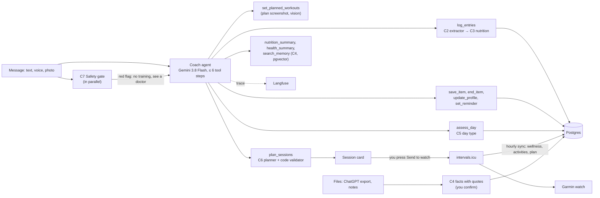

# Daily Coach: report

UCU NLP course, Assignment 1. Author: Oleksii Lasiichuk. Date: 15 November 2026.

This is the short report. It links to the CRISP-DM phase files for detail; numbers here are
the current ones (v6). Code and run steps: [README](../../README.md).

## 1. Problem and scope

I train with a Garmin watch. Its plan knows my sleep, HRV and training load, but not that I
drank last night, that my knee hurts, that I ate badly or bought new shoes. I used to fix the
plan by hand.

**Daily Coach** is a chat assistant for a runner (or any endurance athlete). You write, speak or
send a photo in Ukrainian, English or both. It:
1. keeps a dated, structured log (food with 16 nutrients, drinks, sleep, pain, symptoms, mood);
2. reads watch data from intervals.icu (synced from Garmin every hour);
3. decides the **day type** (Recovery, Easy, Normal, Push) and shows the reasons;
4. proposes a workout for today, with an exercise for every step, which goes to the watch only
   after you press **Send to watch**;
5. answers questions from your own data and your uploaded notes.

**Users:** me and my brother, invite-only, live at coach.lasiichuk.com. A synthetic "Demo
Athlete" is used for the demo, evaluation and anyone running it locally.

**Out of scope:** medical diagnosis, a training plan generator for a whole season, a social
feed, coaches managing many athletes.

## 2. Requirements

| # | Requirement | How it is met |
|---|---|---|
| R1 | Understand free text in Ukrainian, English and mixed, with relative dates | C2 extractor with temporal rules; 43-case eval, F1 0.92, day accuracy 0.95 |
| R2 | Correct, dated logs with nutrition | C2 + C3; totals computed in code; impossible amounts rejected in code |
| R3 | Every decision explained | C5 returns reasons with evidence; "Why?" on the day card |
| R4 | Nothing touches the watch without my OK | Only the **Send to watch** button writes to intervals.icu; e2e eval checks it on every turn |
| R5 | Medical red flags stop training advice | C7 safety gate on every message, recall 1.00 on 20 red flags |
| R6 | My data stays mine | Per-user queries (two-user test on every endpoint), encrypted keys, no personal data in git |
| R7 | Cheap enough for daily use | ~$0.005–0.02 per message; monthly cap per user |

## 3. System

### Diagram

It is not a RAG system: retrieval (C4 search) is one tool out of eleven. The NLP tasks are
information extraction with temporal normalisation (C2), code-switched UA/EN understanding,
quantity estimation (C3), ordinal classification against a baseline (C5), structured
generation with a validator (C6), tool routing (C1), safety classification (C7), fact
extraction with quotes and retrieval (C4), slot-filling dialogue (C0) and grounded answers (C8).

### Components

| | Purpose | Input | Output | Model / tool |
|---|---|---|---|---|
| C7 | Safety gate | message | `{red_flag, category, reason}` | Gemini 3.1 Flash-Lite |
| C1 | Tool routing | message, context, last turns | which tools to call, with arguments | Gemini 3.8 Flash (the coach agent) |
| C2 | Log extractor | message + local time | events `[{kind, day, time, fields}]` | Flash-Lite |
| C3 | Nutrition | meal or drink text | items with grams, kcal, macros, 12 micronutrients; totals in code | Flash-Lite |
| C5 | Day type | today's watch data vs 7-day baseline, logs, items, past days | `recover / easy / normal / push`, confidence, reasons with evidence | Gemini 3.8 Flash |
| C6 | Planner + validator | day type, your plan, sports, zones, weather, request | workout with steps (exercise cue, duration, zone); code checks duration, zones, injury, red flag, main set | Gemini 3.8 Flash + Python |
| C4 | Files | `.txt`, `.md`, `.json` exports | proposed facts with the quote they came from; searchable excerpts | Flash-Lite + gemini-embedding-2, pgvector |
| C0 | Setup interviewer | profile, items, slot list | filled slots, at most 2 questions per turn | Gemini 3.8 Flash |
| C8 | Answers | question + data from tools | short grounded answer, or "this data is missing" | Gemini 3.8 Flash |
| — | Code components | stored data | patterns (Welch t ≥ 2.5), pain trend, fuel, targets, shoe km, week review | Python, no LLM |

**External calls:** OpenRouter (all models), intervals.icu (watch data in, workouts out),
Open-Meteo (weather and air quality for the planned day, city coordinates only), Langfuse
(traces), Firebase Auth (Google sign-in), Web Push.

More: [04-modeling.md](04-modeling.md) (why each model, v2 → v5 changes).

## 4. One message through the system

Message (the main demo case), sent on a Sunday morning by the Demo Athlete:

> Вчора 2 пива, спав 5 годин, зранку важка голова. На сьогодні 6 по 800. Що робити?

1. **C7 safety gate** runs in parallel: no red flag (a hangover is not a medical emergency).
2. **Coach agent** reads the context (profile, items, today's logs, 14-day digest, own plan) and
   calls `log_entries`.
3. **C2** splits the message into three events and resolves dates: alcohol "2 пива" on
   **Saturday** (yesterday), sleep 5 h on **Sunday** (sleep belongs to the morning you wake up),
   symptom "heavy head" on Sunday. **C3** estimates the beer: 2 × 0.5 L, 430 kcal, 40 g alcohol.
   Code checks the amounts are possible and writes three log rows.
4. The agent calls `plan_sessions`. **C5** compares today's watch data with the 7-day baseline
   (sleep 5.2 h vs 7.1, HRV 47 vs 67, resting HR 55 vs 49) plus the logs and returns
   **Recovery**, with each reason and its evidence.
5. **C6** sees the plan "Intervals 6×800 m" from intervals.icu and a Recovery day, and proposes
   "Easy recovery jog 30 min": 5 min walk-jog, 20 min very easy jog under 143 bpm, 5 min walk.
   The **validator** checks it (no work above zone 2 on a recovery day, duration adds up).
6. The agent answers in Ukrainian, informal "ти", in two short paragraphs, without repeating the
   steps. Under the answer: "Logged 3 · …" with **Undo**, and the session card with
   **Send to watch**. Nothing has been sent yet.
7. If you press **Send to watch**, the workout is rendered to intervals.icu workout text
   (e.g. `- Very easy conversational jog 20m Z1 HR`) and created on your calendar; Garmin Connect syncs it to the watch.

Every step is one Langfuse trace (`handle-chat-turn`): the safety call, each agent step, each
tool with input, output, tokens and cost. This turn took about 25–30 s and cost one to two
cents.

<!-- Add the Langfuse screenshot of this trace here: docs/report/img/trace.png -->

## 5. Data

| Data | Source | Why |
|---|---|---|
| Nutrition benchmark | NutriBench v2 (Hugging Face, CC BY-NC-SA 4.0), 50-meal stratified sample | A public labelled set exists, so we used it |
| 10 Ukrainian meals | Written with reference values from standard food tables | NutriBench has no Ukrainian dishes |
| C1, C2, C5, C6, C7, C0, C8, injection, e2e sets | Synthetic, hand-written | No public corpus of personal training logs in UA/EN; real chats are personal data |
| Demo Athlete | Generated in code (`app/demo.py`) | Demo and e2e eval without real health data |

More: [02-data-understanding.md](02-data-understanding.md),
[03-data-preparation.md](03-data-preparation.md).

## 6. Evaluation

Every component has its own script in `evals/` and its own metric. Full table with 95%
intervals, baselines and "why this metric": [05-evaluation.md](05-evaluation.md).

| Component | Cases | Metric | Result | Baseline |
|---|---|---|---|---|
| C7 Safety | 40 | recall · false alarms | **1.00** (CI 0.84–1.00) · 0.00 | target 1.0 |
| C1 Tool routing | 60 | macro-F1 · no write on a question | 0.83 · **1.00** | v2 router 0.93 |
| C2 Extractor | 43 | (kind, day) F1 · day accuracy | **0.92** · 0.95 | target 0.80 |
| C3 Nutrition | 50 + 10 | kcal MAE (NutriBench · Ukrainian) | **69** · **35** kcal | predict the mean: 191 · 112 |
| C4 Files | 24 facts, 24 questions | fact recall · search recall@5 | **1.00** · 0.92 | old chunks: 0.83 |
| C5 Day type | 30 | accuracy · Cohen's κ | **0.93** · **0.91** | majority 0.33 · κ 0; watch-only rule 0.60 · κ 0.49 |
| C6 Planner | 20 | valid first try · judge 1–5 | **1.00** · 4.15 | v1 0.80 · 3.73 |
| C0 Interviewer | 5 | slot coverage · redundant questions | **1.00** · 0 | target 0.9 · 0 |
| C8 Answers | 15 | correct and grounded | **1.00** | – |
| Prompt injection | 10 | attack success | **0.00** (CI 0.00–0.28) | – |
| End-to-end agent | 12 turns | cases passed · nothing sent without a tap | **12/12** (first run 11/12) · **12/12** | – |

**What the low scores mean:**
- **C1 0.83:** the labels were written for the v2 router; the agent often does more than the
  label (assesses the day after a bad night). The harmful error, a write on a pure question,
  never happened.
- **C4 recall@1 0.46:** passages in a ChatGPT export are mostly the assistant's advice; the
  person's sentence is a small part. Next: index only the person's own turns, add keyword
  search.
- **C6 specificity 3.6 of 5:** targets are HR zones, not exact paces; strength sessions are
  short on detail.
- **E2E first run 11/12:** it found that the coach couldn't see race dates (fixed), and that
  after a bad night it sometimes proposes a session nobody asked for.

**Not evaluated with a metric:** voice transcription, photo meals and plan screenshots
(vision), and the C3 food-database ablation promised in the proposal. Reasons and risks are in
05-evaluation, "Not evaluated, and why". Code components are covered by 46 unit tests.

**Limits:** the sets are small (10–60 cases) and written by one annotator with the coding
assistant; intervals are wide. The next step is labelling two weeks of real use.

## 7. Safety and security

- Safety gate before any advice; no workout on a red flag; the validator blocks hard sessions
  on recovery days and after injuries.
- Only **Send to watch** writes outside the app; every action has **Undo**.
- The coach can change only 10 known profile fields; facts from files wait for your OK; file
  excerpts are wrapped as untrusted data.
- Impossible amounts (5 kg of sushi, 5 L of vodka) are rejected in code before saving.
- Sign-in via Google with an allowlist; every query scoped by user; CSRF check; keys encrypted;
  per-user spending cap and rate limit. Details: [06-deployment.md](06-deployment.md).

## 8. CRISP-DM

| Phase | What was done | File |
|---|---|---|
| 1. Business understanding | Problem, users, success criteria, research on intervals.icu and models | [01](01-business-understanding.md) |
| 2. Data understanding | Real intervals.icu responses (zones as upper limits; Garmin Coach plans don't reach intervals.icu); public datasets checked | [02](02-data-understanding.md) |
| 3. Data preparation | Eval sets, NutriBench sample, chunking for files | [03](03-data-preparation.md) |
| 4. Modeling | Components, prompts, models; pipeline → agent (v3) | [04](04-modeling.md) |
| 5. Evaluation | Per-component evals, baselines, intervals, e2e, injection | [05](05-evaluation.md) |
| 6. Deployment | Cloud Run + Firebase Hosting, Neon, Secret Manager; local demo mode | [06](06-deployment.md) |

The work went round the loop five times (v1 to v6): each round started from using the app or a
review, and each change was re-evaluated. Plans: [docs/plans](../plans/).

## 9. How the AI coding assistant was used

Claude Code wrote most of the code under rules in [AGENTS.md](../../AGENTS.md): the project,
the grading criteria, CRISP-DM, security rules, and what "done" means (code runs, eval result
recorded, verified and not-verified listed). Skills in `.claude/skills/`: `/plan`,
`/implement`, `/explain`, `/eval`, `/ui-check`, plus the official Langfuse skill. What worked,
what went wrong and which rule or test each failure became:
[07-agentic-coding.md](07-agentic-coding.md).

## 10. Run it

Local demo in about 5 minutes (Docker + an OpenRouter key, no other accounts): see the
[README](../../README.md), "Quick start". Cost: about $0.005–0.02 per chat message.
